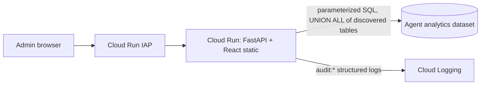

# BQCA Conversation Audit UI

An admin console for auditing, reviewing, filtering and searching conversations
with **BigQuery Conversational Analytics (BQCA) data agents**. It reads the event
logs written by the **ADK BigQuery Agent Analytics plugin** and deploys to
**Cloud Run behind IAP** with a single script.

- **Stack:** React + Vite + Tailwind + ECharts frontend, served by a FastAPI backend, in one container.
- **Access model:** sign-in through IAP. The backend reads BigQuery with a dedicated read-only service account.

## Features

| Screen | What admins get |
|---|---|
| **Overview** | KPIs with change vs. the previous period, activity/latency/token charts, weekday×hour heatmap, top questions, review flags, per-agent and per-user breakdowns, latency histogram, models. Banners point out logging gaps. |
| **Conversations** | Full-text search over prompts, answers and IDs. Grouping **by session** or **by thread** (same user + agent, split after an inactivity gap). Filters for flags, latency, tokens and data results. Sortable, paginated, CSV export. Filter state lives in the URL, so links can be shared. |
| **Conversation detail** | Chat transcript with the rendered markdown, insights, data-artifact references, clarifying questions and follow-ups. Each turn shows tokens, latency, model, finish reason and tool security verdicts. Also a span waterfall, raw event JSON, and a shareable link. |
| **Users / Agents** | Per-user and per-data-agent usage, latency, token and cache stats, and grounding rate. |
| **Viewer audit trail** | Conversation views, searches and CSV exports are logged to Cloud Logging with the viewer's IAP email. |

### Review flags

| Flag | Rule |
|---|---|
| `ERROR` | an event has `status = ERROR` or an `error_message` |
| `TRUNCATED` | `is_truncated = true` |
| `TOOL_DENIED` | an `orcas_tool_call_security_check_states` verdict is not `ALLOW` |
| `UNGROUNDED_TABLE` | the answer has a numeric markdown table while `skip_data_queries = true` |
| `EMPTY_ANSWER` | no `AGENT_RESPONSE`, or empty answer text |
| `SLOW` | turn latency ≥ `SLOW_MS` (default 15 s) |
| `HIGH_TOKENS` | turn tokens ≥ `HIGH_TOKENS` (default 100k) |
| `CLARIFYING_Q` | the agent asked a clarifying question |

## Architecture



- **Table discovery:** the backend uses every table in `DATASET` that has the `TABLE_LABEL` label (default `adk_schema_version`, set by the plugin) and has the required columns. New agent tables appear within 5 minutes.
- **CMEK-safe:** queries build an explicit `UNION ALL` rather than wildcard (`*`) tables, which BigQuery rejects on CMEK-encrypted datasets.
- **Correctness:** events are deduplicated by `event_id`. Turn latency uses `MAX` because `INVOCATION_COMPLETED` can be emitted twice per invocation.
- **Safety:** all user input goes in as BigQuery query parameters. Identifiers are validated or whitelisted. Every query is filtered by time range (partition pruning) and capped with `maximum_bytes_billed`.
- **Least privilege:** the runtime SA gets `roles/bigquery.jobUser` on `PROJECT_ID` and `roles/bigquery.dataViewer` on `DATASET` only. Only the IAP service agent has `roles/run.invoker`.

## Prerequisites

- A dataset populated by the [ADK BigQuery Agent Analytics plugin](https://google.github.io/adk-docs/) (schema v2 columns: `timestamp`, `event_id`, `event_type`, `agent`, `session_id`, `invocation_id`, `user_id`, `trace_id`, `span_id`, `parent_span_id`, `content`, `content_parts`, `attributes`, `latency_ms`, `status`, `error_message`, `is_truncated`).
- `gcloud` (a recent release; IAP on Cloud Run needs the `--iap` flag), `bq` and `python3`.
- The deployer needs permission to enable services, create service accounts, set project IAM, deploy Cloud Run via Cloud Build, manage IAP policy, and run `GRANT` on the dataset. Project Owner covers all of these.
- IAP is used with a Google-managed OAuth client. Check the [IAP for Cloud Run docs](https://cloud.google.com/iap/docs/enabling-cloud-run) for who can be granted access in your organization.

## Deploy

```bash
cp deploy.env.example deploy.env   # set PROJECT_ID, DATASET, IAP_MEMBERS
./deploy.sh
```

`deploy.sh` is idempotent. It enables the required APIs, creates the runtime service account and its grants, builds with Cloud Build, deploys with IAP enabled, restricts the invoker, and grants IAP access to `IAP_MEMBERS`. Re-run it to roll out code changes or add members.

| Variable | Required | Default | Purpose |
|---|---|---|---|
| `PROJECT_ID` | yes | — | Cloud Run project; runs and pays for the BigQuery jobs |
| `DATASET` | yes | — | Dataset containing the agent-analytics tables |
| `IAP_MEMBERS` | yes | — | Comma-separated IAM members, e.g. `group:admins@example.com` |
| `DATA_PROJECT_ID` | no | `PROJECT_ID` | Project owning `DATASET`, if different |
| `REGION` | no | `us-central1` | Cloud Run region |
| `SERVICE` / `SA_NAME` | no | `bqca-audit-ui` | Service and service-account names |
| `SLOW_MS` / `HIGH_TOKENS` | no | `15000` / `100000` | Review-flag thresholds |
| `MAX_BYTES_BILLED` | no | 20 GiB | Per-query cost guard |
| `TABLE_LABEL` | no | `adk_schema_version` | Label that marks agent tables; empty = all tables |

To remove everything the script created (the dataset itself is left alone):

```bash
./destroy.sh
```

To find who viewed what:

```
resource.type="cloud_run_revision"
resource.labels.service_name="bqca-audit-ui"
jsonPayload.message=~"^audit:"
```

## Local development

```bash
# Backend (uses your Application Default Credentials)
cd backend
python3 -m venv .venv && .venv/bin/pip install -r requirements-dev.txt
PROJECT_ID=my-proj DATASET=my_dataset .venv/bin/uvicorn main:app --port 8080 --reload

# Frontend with hot reload: http://localhost:5173, /api proxied to :8080
cd frontend && npm install && npm run dev
```

To serve the production build from the backend instead: `npm run build`, then start uvicorn with `STATIC_DIR=../frontend/dist`.

## Tests

```bash
cd backend && .venv/bin/pytest -q                        # offline unit tests
cd tests/e2e && npm install && \
  BASE=http://127.0.0.1:8080 CHROME_PATH=/usr/bin/google-chrome npm test   # headless smoke test
```

The smoke test loads every screen and opens the first conversation it finds. It fails on any console error or failed API call, and saves screenshots to `tests/e2e/shots/`.

## Project layout

```
backend/            FastAPI app (main.py), SQL builders (queries.py), tests
frontend/           React + Vite app (src/pages, src/components)
tests/e2e/          Puppeteer smoke test
Dockerfile          Multi-stage build: frontend, then Python runtime (non-root)
deploy.sh           Idempotent Cloud Run + IAP deployment
destroy.sh          Teardown
deploy.env.example  Configuration template
```

## Known limitations (caused by the source logs)

1. If the agent doesn't emit `TOOL_*` events, **the generated SQL and result rows can't be audited**. Answers then only carry `data_result_artifact_name`. The UI shows a banner when this happens.
2. BQCA may issue a new `session_id` for every turn. "By thread" grouping is a heuristic workaround.
3. `user_id` may be a GAIA ID or a caller identity rather than an email address. Mapping it to a person requires a directory lookup outside this app.
